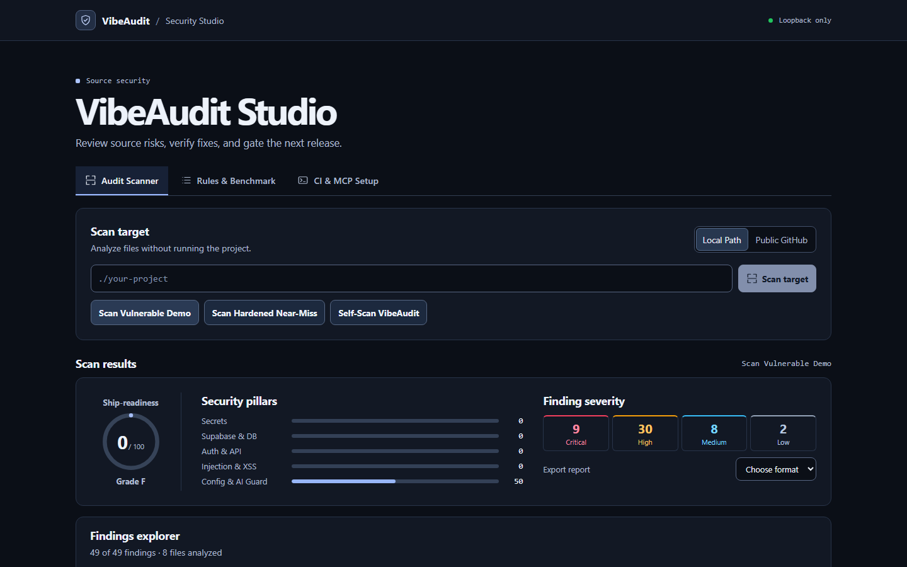
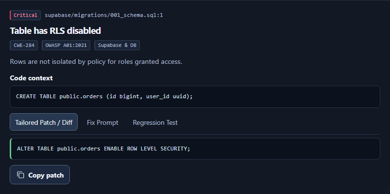
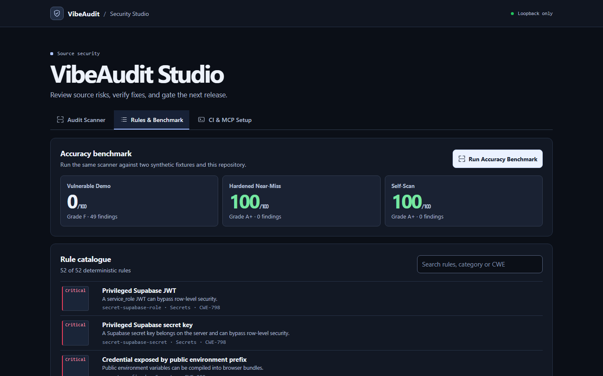
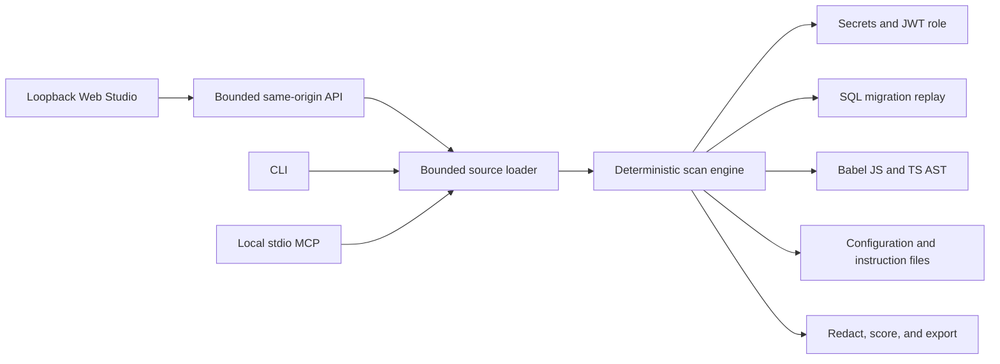

# VibeAudit

**Find source risks before you ship. Review the evidence, fix the code, and gate the next release.**

 [](LICENSE)

VibeAudit is a local static security scanner for Next.js, Supabase, and Stripe projects. The Web Studio, CLI, and stdio MCP server share one deterministic engine. No account, API key, or analysis service is required.



## Quick start

Requires Node.js 18.18+ and npm. Git is needed for public repository checkout and tracked dotenv inventory.

```sh
npm ci
npm run build
npm start
```

Open [http://127.0.0.1:3000](http://127.0.0.1:3000). Scan a local folder, enter a public GitHub repository, or start with **Scan Vulnerable Demo**. Inspect the redacted evidence and suggested repair before exporting or copying anything.

### CLI

```sh
npm run cli -- rules
npm run cli -- scan ./my-project --fail-on high
node bin/vibeaudit.cjs scan ./my-project --json
node bin/vibeaudit.cjs scan ./my-project --sarif > report.sarif
node bin/vibeaudit.cjs scan ./my-project --md > report.md
```

The direct commands require a prior build (or `npm run build:tools`) and write the report to stdout. Exit `0` means the specified threshold was not reached; `1` means it was or coverage was incomplete with a threshold enabled; `2` signals invalid usage or an unsuccessful scan. Default threshold: `none`. Repeat `--exclude PATH` for reviewed repository-relative exclusions.

### MCP

Build once. Configure your local stdio client with a real absolute path for the script:

```json
{
  "mcpServers": {
    "vibeaudit": {
      "command": "node",
      "args": ["/absolute/path/to/vibeaudit/bin/vibeaudit-mcp.cjs"]
    }
  }
}
```

| Tool | Arguments | Result |
|---|---|---|
| `vibeaudit_scan_path` | `{"path":"/path/to/project"}` | Score, redacted findings, suggested repairs, and warnings |
| `vibeaudit_list_rules` | `{}` | Rule catalogue |
| `vibeaudit_generate_ci` | `{"threshold":"high"}` | GitHub Actions workflow YAML |

### Agent skill

Start with [SKILL.md](SKILL.md) or the [installable skill directory](skills/vibeaudit-audit/SKILL.md). Four playbooks cover Supabase RLS, Next.js auth, secrets and webhooks, and the fix-and-verify loop. Once this repository is published, install with `npx skills add hanphanr1/vibeaudit`.

### CI

Select a threshold under **CI & MCP Setup**, then save the downloaded workflow to `.github/workflows/vibeaudit.yml`. Replace `<PINNED_COMMIT_SHA>` with the reviewed scanner commit; the workflow refuses to build the scanner without a 40-character SHA. The scan writes SARIF and fails the job on incomplete coverage or findings at the chosen threshold. VibeAudit’s own [CI workflow](.github/workflows/ci.yml) tests and builds on Node 18.18.0 and 20, then gates its self-scan at Low.

## Inspect before patching



Each finding includes a file and line, CWE and OWASP category, masked context, a suggested repair, and a regression check. Review database roles, source ownership, and local conventions before applying changes. VibeAudit never applies patches or executes the scanned project's code.

## Benchmark



| Target | Score | Grade | Findings |
|---|---:|:---:|---:|
| Vulnerable Demo | 0/100 | F | 49 |
| Hardened Near-Miss | 100/100 | A+ | 0 |
| Self-scan (excludes `fixtures/` and `tests/`) | 100/100 | A+ | 0 |

The vulnerable demo covers 49 of 52 rules. Tracked dotenv and the two install-hook rules are verified separately without running install hooks. The near-miss fixture exercises public anon JWTs and publishable Supabase keys, later RLS migrations, scoped policies, verified sessions, a raw-body Stripe webhook, sanitized rendering, and argument-vector subprocess calls. Zero findings on these controls does not estimate the false-positive rate on arbitrary projects.

## How it works



- Local scans need no network. Public GitHub scans fetch a filtered, shallow repository by HTTPS; the scanner checks staging size every 50 ms during fetch, stops over-budget fetches, and verifies tree size before checkout. The staging check is sampled, not a filesystem quota. Temporary directories are removed afterward; symlinks and submodules are never checked out. API POSTs require a loopback Host and its exact matching HTTP Origin. If Sec-Fetch-Site is present, it must be same-origin. Responses are not cached.
- Per-file and aggregate limits cap reads. Known binary assets, protected dotenv files, generated output and explicit exclusions count as benign skips. Read failures, parser failures, unhandled SQL that can change access, escaping links, omitted checkout paths and exhausted budgets mark coverage incomplete. Tracked dotenv is identified from the Git index; contents are not read.
- SQL replay covers supported static statement shapes, including access changes through `ALTER FUNCTION` and `ALTER ROUTINE`, not arbitrary dynamic SQL or server state. Authentication checks require a recognized provider binding and an identity check before writes; a helper name alone is not evidence, and a project-local `@/auth` or `@/lib/supabase/server` wrapper counts only when its own source resolves to a recognized SDK. A score of 100 means none of the supported rules matched the files read, not that the application is secure.

## Related tools

This matrix summarizes each linked project’s documented focus. It does not claim unsupported features are absent.

| Project | Documented surfaces | Documented focus |
|---|---|---|
| **VibeAudit** | Web Studio, CLI, stdio MCP, CI YAML, installable skill | Babel AST, migration replay, JWT roles, suggested repairs and benchmark controls |
| [vibe-shield](https://github.com/avivgerz-hue/vibe-shield) | CLI and MCP | SAST, secrets, Supabase RLS and instruction-file guard |
| [AXguard](https://github.com/awarexone/AXguard) | Python project | Security scanning and proposed fixes for generated applications |
| [shipwarden](https://github.com/patrickballard/shipwarden) | CLI | Supabase RLS, leaked keys, Firebase rules and launch checklist |
| [nextjs-supabase-stripe-security-checker](https://github.com/edtrackai/nextjs-supabase-stripe-security-checker) | CLI and GitHub Action | API grants, leaked keys, RLS, and Stripe webhooks |

[Contributing](CONTRIBUTING.md) · [Private disclosure](SECURITY.md) · [MIT](LICENSE)
